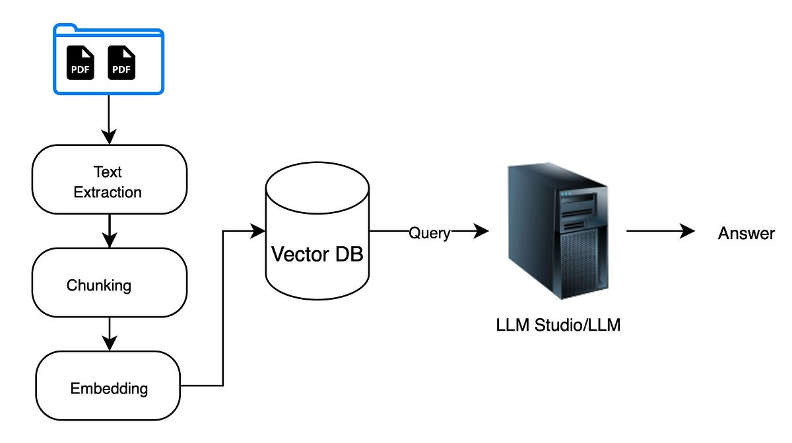
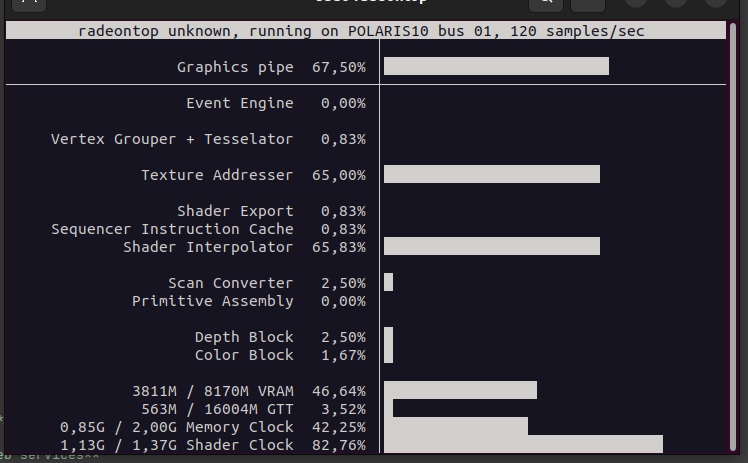

# I built a chatbot for my PDFs that runs entirely on my laptop

## Why I looked into this at all

Almost every company I've worked with or around has the same problem. There is a huge amount of documentation: product manuals, specs, price lists, internal guides, PDFs, Word files, tables in a database. Nobody reads it all. People search, give up, and ask a colleague.

That pile of text is useful, though. I kept seeing two obvious uses:

- **A bot for customers.** They ask "does this model support X?" or "how do I configure Y?" and get an answer taken from the real documentation, with a source, instead of waiting for support.
- **A bot for technical and call managers.** Someone on the phone with a client needs a quick answer about a product, a limit, or a compatibility detail. Today that means digging through files or interrupting an engineer.

Clients keep asking about this, and I didn't want to promise something I'd never tried. So I decided to build a small version myself and find out how hard it really is, where it breaks, and what it costs to run.

Companies are also often unwilling to send internal documents to a third-party cloud, which is the second reason for going local.

## What I set out to build

I wanted to ask questions about a pile of documents and get answers back. Not "summarize this file", more like "what does the spec say about X", across hundreds of PDFs. I also didn't want to upload any of it anywhere. So: local model, local database, plain Python.

There are products that do this in three clicks. I skipped them on purpose. I wanted to understand what actually happens between "I have a PDF" and "the bot answered", and the only way I know to do that is to build it ugly and small and watch it break. This is the story of that build, including the parts that went wrong.

Stack, for the record: Python 3.10, PyMuPDF, Ollama for both models, Qdrant in local mode, pytest.

## The idea in one picture

An LLM knows nothing about your files, and you can't paste 1000 PDFs into a prompt. So you don't. You find the three or four paragraphs that matter for the current question and hand only those to the model. That's all RAG is.



The left column happens once, when you index the documents. The right part happens on every question: the question is embedded the same way, the closest chunks come back from the vector DB, and the LLM writes the answer from them.

Honestly, I read this kind of diagram many times before it clicked. It clicked when I wrote the code.

## Wait, why two models?

This was the first thing that confused me. I had `qwen3` installed and assumed I'd use it for everything. But a chat model writes text, and what I needed for search was a way to compare *meaning*. That's an embedding model: it turns a piece of text into a long list of numbers, and texts that mean similar things end up with similar numbers. That's why "what is his education" can find a paragraph that says "Master's Degree, Computer Science" without sharing a single word with the question.

So I pulled a small one next to the chat models:

```bash
ollama pull qwen3-embedding:0.6b
ollama list
# qwen3-embedding:0.6b   639 MB
# qwen3:latest           5.2 GB
# qwen3:0.6b             522 MB
```

## Chunking

You can't embed a whole PDF as one vector. It would be a blurry average of everything in it. So I cut the text into pieces. I went with 1200 characters and 200 characters of overlap, which isn't scientific, it's just a number that felt reasonable. The overlap is there so a sentence that lands on a boundary survives whole in at least one chunk.

```python
def split_text(text, chunk_size=1200, overlap=200):
    text = " ".join(text.split())
    chunks, start = [], 0
    while start < len(text):
        end = min(start + chunk_size, len(text))
        chunks.append(text[start:end])
        if end == len(text):
            break
        start = end - overlap
    return chunks
```

One decision I'm happy with: I chunk page by page, so a chunk never spans two pages. Every chunk knows its file and page number, which means the bot can say "page 2 of 2026-09-magento-developer.pdf" later. If you do this at the very end it's painful. Doing it from the start cost nothing.

```python
with pymupdf.open(path) as doc:
    for i, page in enumerate(doc):
        for t in split_text(page.get_text("text")):
            chunks.append(Chunk(text=t, source=path.name, page=i + 1))
```

## Storing vectors

Qdrant has a local mode where the "database" is just a folder. No Docker, no server. For a learning project that's perfect.

```python
client = QdrantClient(path="data/qdrant")
client.create_collection(
    collection_name="localdocs",
    vectors_config=models.VectorParams(size=vector_size, distance=models.Distance.COSINE),
)
```

Each point gets the vector and a payload with the text, file name and page. And this is where I got my first real error:

```
ValueError: Point id 1488fdb0...d8 is not a valid UUID
```

I'd used a SHA-256 hash as the point ID, because it was deterministic and I liked that. Qdrant only takes integers or UUIDs. The fix was `uuid5`, which is also deterministic:

```python
point_id = str(uuid.uuid5(uuid.NAMESPACE_URL,
               f"{chunk.source}:{chunk.page}:{index}:{chunk.text}"))
```

(Side note: `index` there is the position inside the current batch, not a global one. So re-ingesting is only safe with the same batch size. I know. It's on the list.)

Ingestion itself embeds in batches of 32 so memory doesn't blow up on big folders. The first batch also tells me the vector size, since it depends on the model:

```python
first = embedder.embed([c.text for c in chunks[:32]])
store.ensure_collection(vector_size=len(first[0]))
```

I ran it on one CV, got `Indexed 6 chunks.`, and immediately wondered how to look inside. Local mode has no web UI. I ended up writing a tiny script that dumps the points. There's a Docker script in the repo for a real Qdrant server with a dashboard, but I haven't switched to it yet. One more thing that bit me: local mode locks the folder, so you can't run the inspector while the bot is open.

## First time retrieval worked

Before touching the chat model I tested search on its own, because if search is bad nothing downstream can save you.

```
Ask a question: waht is his education

--- Result 1 ---   page 2   score 0.3240
... EDUCATION  Engineer's / Master's Degree, Computer Science, Omsk State Technical University, 2002-2007
```

Right chunk, first place, and that's with a typo in the question ("waht", I didn't even notice). A score of 0.32 looks bad if you're used to percentages. It isn't one. With cosine similarity from a small model, only the ranking matters.

## The answer step, and where the small model got annoying

Retrieved chunks go into a prompt, and I call the model with `temperature=0` so it doesn't get creative:

```python
client.chat(
    model="qwen3:0.6b",
    messages=[{"role": "user", "content": prompt}],
    options={"temperature": 0, "num_predict": 250},
    think=False,
)
```

`think=False` matters. Qwen3 likes to reason before answering, and those tokens count against `num_predict`, so with thinking on I got truncated answers and longer waits.

The 0.6B model is fast but sloppy, and my prompt grew by one rule every time it did something dumb. It made up facts, so now it has to use the excerpts only. It wrote essays like "the document does not explicitly state, however based on the provided information...", so now it has to be short. The best one: the CV said "20+ years" and the model answered "20 years". The plus sign is the entire point, so there's now a rule about keeping numbers and qualifiers exactly as written. It also decided a language, a framework and a platform were all the same kind of thing, which earned another rule.

After that:

```
You: How many years of Magento experience does he have?
Assistant: The document states "20+ years of experience building and customizing
online stores on Magento (2.x and 1.x)...". Answer: 20+ years. Source: 2026-09-magento-developer.pdf, page 1.
```

And when the answer isn't in the documents (I asked for a favorite programming language, a CV doesn't say), it says it couldn't find it, instead of inventing something. That behavior is the real test of a RAG bot, and it took the most prompt fiddling.

I also tell it to treat the excerpts as data, not instructions. A PDF containing "ignore previous instructions" shouldn't be able to steer the bot. Cheap to add, and I'd rather have it than not.

## Where the time goes

I assumed the vector search would be the slow part. It isn't:

```
[Timing] Retrieval:  0.12s
[Timing] Generation: 10.50s
[Timing] Total:      10.61s
```

Retrieval is noise. Generation is basically the whole wait. Good to know before I'd spent a weekend optimizing the wrong thing. If I want it faster, the levers are a smaller model, fewer chunks in the prompt, or a GPU. I also added timestamps to the chat output and print Ollama's tokens-per-second, so I can compare runs without guessing.

A later session on the same project looked quite different:

```
You: give me his name
[Timing] Embedding: 0.03s
[Timing] Qdrant search: 0.00s
Prompt eval: 0.52 s
Generation eval: 2.24 s
Generated tokens: 284
Tokens/sec: 126.7
[Timing] Total: 3.01s

Assistant: The answer is Alexander Neverovsky.
```

Three seconds for the simplest question, about 6.5 for a longer one, at roughly 126 tokens per second. The first run was around 10. I didn't change the pipeline between them, so I can't say exactly what made the difference (the model that was loaded, or what else the machine was doing, are my guesses). It's a good reminder to repeat a measurement before believing it.

The numbers also show something else: generation time follows the number of tokens produced. 284 tokens took 2.2 s, 717 tokens took 5.7 s. So a shorter answer is a faster answer, and the "keep it concise" rule in the prompt is also a speed setting.

For the record, this is not a fancy machine. My GPU is a Radeon RX 580, an old 8 GB card that was always fine for backend and frontend work and is now being asked to do something new. Here is what `radeontop` showed while the model was working:



The card is clearly busy (graphics pipe about 67%, shader clock about 83%) and about 3.8 GB of the 8 GB of VRAM is in use. And keep in mind what the workload was: a single question, answered from a few chunks of a 1-2 page PDF. That's about the smallest job this system will ever get. With 1000 documents, bigger prompts and several people asking at once, this old card would be under much more pressure, so I wouldn't read the numbers as headroom. I'd read them as "it works, and it's already not idle".

Still, for a 0.6B model an old consumer card is enough to try the idea, so you don't need an expensive GPU to find out whether this is useful for you.

## And the answers are still not perfect

The second question in that session was "which frameworks or technologies he know?". The bot gave a long bulleted list with a citation for each line. Technically it answered, but:

- it ignored the "1-3 sentences or a short list" rule and produced 717 tokens
- it listed Magento, Shopify and WooCommerce next to PHP and MySQL, which is exactly the language / framework / platform mixing I had tried to forbid in the prompt
- it described Cypress as "unit testing", which I'd bet is not what the CV says

The facts were all in the source, and the sources were cited correctly, so retrieval did its job. The weak part is the 0.6B model following instructions, and a longer prompt didn't fix it. The honest options are a bigger model (`qwen3:latest`, at the cost of speed), or accepting that a tiny model gives you "mostly right, a bit messy" answers. For a demo that's fine. For something a call manager relies on during a client call, I wouldn't ship it without a stronger model and a set of test questions.

## Tests

Each stage has its own test file. The embedding test needs Ollama running, so it's marked and can be skipped:

```bash
python -m pytest -m "not integration"
```

My very first run said `collected 0 items / 1 error`. Plain `pytest` couldn't import `src`. Adding `pythonpath = .` to `pytest.ini` fixed it. A boring problem, but I lost a few minutes to it, so here it is.

A few other things I'd tell past me: always close the Qdrant client in a `finally`, because of that lock. If you change the embedding model, the vector size changes, and you need to delete `data/qdrant` and re-index.

## Try it

```bash
python -m venv .venv && source .venv/bin/activate
pip install -r requirements.txt
# drop PDFs into data/pdfs/
python -m src.ingest
python -m src.chat
```

## What I'd do next

The console was never the end goal. The plan is a small chat app in the browser, a React frontend talking to the Python bot over WebSockets, so the answer can stream in as it's generated. That deserves its own write-up, so it will be the next article.

My original goal was 1000 mixed PDFs and DOCX files, and I've only done a handful of PDFs, so DOCX is next. After that I want smarter chunking (by paragraph or heading instead of a fixed character count), skipping files that are already indexed, and the Docker Qdrant with its dashboard. I'd also like a small set of questions with known answers that I can re-run after every change, because right now "it seems better" is my whole evaluation method, and that's not great.

What stuck with me: the pipeline is five boring steps, and nearly all the real work is in the details. When an answer comes out wrong, look at the retrieved chunks first. Nine times out of ten the model is fine and the search handed it the wrong paragraphs.
